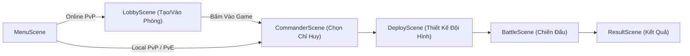

# ANOTHER BATTLE: HẢI CHIẾN CHIẾN THUẬT
## Master Task Overview & Implementation Roadmap

> **Phiên bản:** 1.0 | **Engine:** Phaser 3.88+ & Vite 6 | **Backend Online PvP:** Node.js WebSocket (`ws`)
> **Độ phân giải chuẩn:** $1280 \times 720\text{ px}$ (Tỷ lệ 16:9 Tactical Naval Radar Console) | **Bản đồ:** Lưới $10 \times 10$

---

## 1. Giới thiệu dự án
**Another Battle** là tựa game chiến thuật hải quân bắn tàu theo lượt lấy cảm hứng từ *Battleship*, nâng cấp chiều sâu chiến thuật với:
- **Đội hình đa hình dáng (22 ô đơn vị cơ bản):** Gồm Căn cứ chỉ huy chữ thập (`+`, 5 ô), Tàu sân bay (5 ô), Thiết giáp hạm (4 ô), 2 Tàu tuần dương ($3 \times 2 = 6$ ô) và Tàu do thám (2 ô).
- **Kho đạn pháo chiến thuật:** Đạn thường ($1\times 1$), Đạn chùm ($3\times 3$, dùng 1 lần), Đạn nảy (nảy ngẫu nhiên thêm 2 ô chưa bắn, dùng 1 lần).
- **Hệ thống 5 Chỉ huy & Kỹ năng riêng biệt:** Phân tách, Thuyền ma (mồi nhử 3 ô), Di tản, Đạn dò tìm ($3\times 3$), Sương mù (che quan sát 2 lượt).
- **Luồng trải nghiệm chuẩn:**
  `Menu Chính` $\rightarrow$ `Tạo Phòng / Vào Phòng` $\rightarrow$ `Vào Game` $\rightarrow$ `Chọn Chỉ Huy` $\rightarrow$ `Thiết Kế Đội Hình` $\rightarrow$ `Chiến Đấu Theo Lượt` $\rightarrow$ `Kết Quả & Tái Đấu`.

---

## 2. Bảng tổng hợp Tasks (Tasks Matrix)

| Mã Task | Tiêu đề Task | Module phụ trách | Độ ưu tiên | Trạng thái |
| :--- | :--- | :--- | :---: | :---: |
| **[TASK-01](TASK-01_PROJECT_SETUP_AND_ARCHITECTURE.md)** | Khởi tạo dự án Vite + Phaser 3 & Cấu trúc Client/Server | `package.json`, `vite.config.js`, `src/main.js` | **P0 (Critical)** | ✅ Hoàn thành |
| **[TASK-02](TASK-02_BOARD_ENGINE_AND_22_CELL_FLEET.md)** | Hệ thống Bản đồ $10\times 10$ & Đội hình 6 Đơn vị (22 ô) | `src/shared/constants.js`, `src/shared/BoardEngine.js` | **P0 (Critical)** | ✅ Hoàn thành |
| **[TASK-03](TASK-03_TURN_COMBAT_AND_AMMO_ARSENAL.md)** | Cơ chế Bắn theo lượt (Bonus Turn) & 3 loại Đạn pháo | `src/shared/AmmoSystem.js`, `src/shared/BoardEngine.js` | **P0 (Critical)** | ✅ Hoàn thành |
| **[TASK-04](TASK-04_COMMANDER_SKILLS_SYSTEM.md)** | Hệ thống 5 Chỉ huy & Kỹ năng đặc biệt | `src/shared/CommanderSkills.js` | **P0 (Critical)** | ✅ Hoàn thành |
| **[TASK-05](TASK-05_MENU_AND_ONLINE_LOBBY_SCENE.md)** | Màn hình Menu chính & Phòng chờ Online (`Tạo phòng -> Vào game`) | `src/scenes/MenuScene.js`, `src/scenes/LobbyScene.js` | P1 (High) | ✅ Hoàn thành |
| **[TASK-06](TASK-06_COMMANDER_SELECTION_SCENE.md)** | Màn hình Chọn Chỉ Huy (`Vào game -> Chọn chỉ huy`) | `src/scenes/CommanderScene.js` | P1 (High) | ✅ Hoàn thành |
| **[TASK-07](TASK-07_FLEET_DEPLOYMENT_SCENE.md)** | Màn hình Thiết Kế Đội Hình $10\times 10$ (`Chọn chỉ huy -> Thiết kế đội hình`) | `src/scenes/DeployScene.js` | **P0 (Critical)** | ✅ Hoàn thành |
| **[TASK-08](TASK-08_TACTICAL_RADAR_BATTLE_SCENE.md)** | Màn hình Chiến Đấu Radar Đôi, Vũ khí, Kỹ năng & Local PvP | `src/scenes/BattleScene.js`, `src/utils/RadarRenderer.js` | **P0 (Critical)** | ✅ Hoàn thành |
| **[TASK-09](TASK-09_WEBSOCKET_MULTIPLAYER_SERVER.md)** | Máy chủ WebSocket Online PvP & Đồng bộ Fog-of-War | `server/index.js`, `src/network/NetworkManager.js` | P1 (High) | ✅ Hoàn thành |
| **[TASK-10](TASK-10_TACTICAL_AI_AND_AUDIO_VFX_POLISH.md)** | Trí tuệ nhân tạo PvE, Âm thanh WebAudio, Kết quả & Unit Tests | `src/shared/TacticalAI.js`, `src/utils/SoundSynthesizer.js`, `tests/` | P1 (High) | ✅ Hoàn thành |

---

## 3. Luồng Màn Hình & Sơ Đồ Phụ Thuộc (Execution Flow)



```mermaid
flowchart TD
    subgraph Phase 1: Core Architecture & Shared Engine
        T01["TASK-01: Project Setup"] --> T02["TASK-02: Board 10x10 & 22-Cell Fleet"]
        T02 --> T03["TASK-03: Turn Combat & 3 Ammo Types"]
        T02 & T03 --> T04["TASK-04: 5 Commander Skills"]
    end

    subgraph Phase 2: Pre-Battle Flow
        T01 --> T05["TASK-05: Menu & Room Lobby"]
        T04 & T05 --> T06["TASK-06: Commander Selection Scene"]
        T02 & T04 & T06 --> T07["TASK-07: Fleet Deployment Scene"]
    end

    subgraph Phase 3: Battle, Multiplayer & Polish
        T03 & T04 & T07 --> T08["TASK-08: Tactical Radar Battle Scene"]
        T05 & T08 --> T09["TASK-09: WebSocket PvP Server"]
        T08 & T09 --> T10["TASK-10: Tactical AI, Audio VFX & Tests"]
    end
```

---

## 4. Quy tắc chất lượng (Definition of Quality)
1. **Luồng chuẩn xác:** Đảm bảo đúng thứ tự trải nghiệm `Menu -> Tạo phòng / Vào phòng -> Vào game -> Chọn chỉ huy -> Thiết kế đội hình -> Chiến đấu`.
2. **Bảo mật thông tin (Fog of War):** Đối phương không bao giờ biết vị trí tàu chưa chìm hoặc không phân biệt được Thuyền ma cho tới khi bắn hạ hết 3 ô của Thuyền ma.
3. **Đồng bộ Logic (Shared Core):** Mọi quy tắc đặt tàu, bắn đạn và kỹ năng chỉ huy được kiểm chứng qua bộ Unit Tests tự động (`npm test`).

